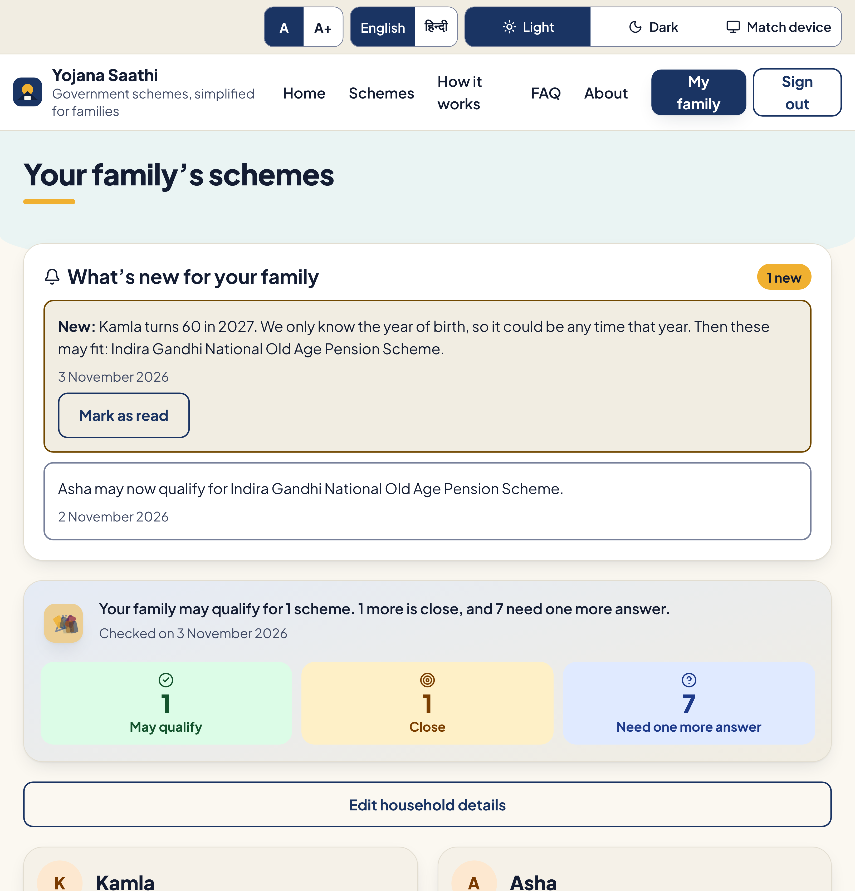
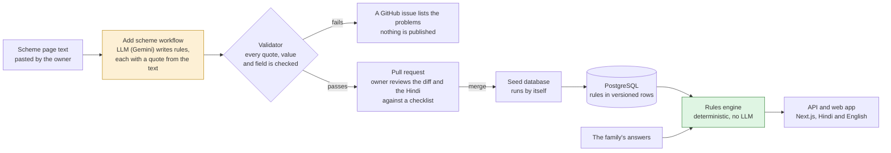

# Yojana Saathi

**Live: <https://yojana-saathi-hazel.vercel.app>**

> An independent student project. **Not a government app.** Guidance only, not an official decision.

Yojana Saathi is a free web app, in Hindi and English, for families in Uttar Pradesh. A family sets up
its household once: where it lives, what kind of house, its income band, and each person (age,
work, studying, and the papers they hold). The app then shows every government scheme each member
may qualify for, the papers still missing, the schemes that are a near miss, and why, with a link to
the official source. Nothing is applied for on anyone's behalf, and no Aadhaar, PAN, bank or
certificate **numbers** are ever stored: papers are only "has / does not have".



*The dashboard for a made-up example family. A scheme that depends on the whole family (here, a
housing scheme) is shown once; the people's cards follow.*

## The principle: the LLM never decides eligibility

A language model helps **write down** a scheme's rules from its official text. It never decides who
qualifies. Every answer a family sees comes from a small, deterministic rules engine
([`backend/app/rules/engine.py`](backend/app/rules/engine.py), written by hand, no network, no model),
and every rule it uses was checked by a validator and then read by a person before it went live.

## How a scheme gets in



The model only appears on the left. A merge is the only way a scheme reaches families, and the
person who merges is the one who verifies it ([`docs/scheme-review-checklist.md`](docs/scheme-review-checklist.md)).

## How the household rules work

A scheme is a list of rules in JSON. Each rule reads one fact. Some facts are about the **household**
(state, village or town, kind of house, income band, social category, BPL list), some about a
**person** (age, gender, studying, work, a paper held), and a rule can be about the **members as a
group** (`any_member`: "no member pays income tax"). For example, PMAY-Gramin, the rural housing
scheme, is three rules:

```json
{"all": [
  {"field": "area_type", "op": "eq", "value": "rural"},
  {"field": "house_type", "op": "in", "value": ["no_house", "kutcha"]},
  {"not": {"any_member": {"field": "paid_income_tax_last_year", "op": "is_true"}}}
]}
```

- Each answer is **eligible**, **near miss** (fails only something fixable, such as a missing
  paper), **not eligible**, or **unknown**. A fact the family has not given makes the answer
  *unknown*, never "no", and the app asks for it.
- We hold a birth year and an income **band**, not exact values, so near an age or income limit the
  answer is "may qualify, check the official page" and not a false yes or no.
- A scheme whose rules are only about the household or `any_member` gives the same answer for every
  member, so the dashboard shows it **once**, under "For the whole family".
- Conditions the rules cannot express (a sworn affidavit, "no other LPG connection") are said plainly
  on the scheme page under "Rules we can't check: ask the office".

## What the validator has caught

The extractor's proposals are checked before a person sees them. Real mistakes from adding the first
schemes, and what stopped each one:

| Mistake | What stopped it |
| --- | --- |
| Category written as `"obc"` instead of `"OBC"` (two proposals in a row) | The validator compares exactly: such a rule would match nobody. The prompt now lists every allowed value, from the same table the validator reads. |
| Papers ("Aadhar number", "Income certificate") written as **eligibility rules** | The validator allows a paper rule only when the Eligibility section itself says so; rule quotes may come only from Details, Eligibility or Exclusions. |
| `is_bpl` compared with the text `"yes"` | The validator checks the kind of value each field holds (a yes/no field takes true or false). |
| A benefit text with rupee amounts whose quote contained no numbers | The validator requires every number in the benefit text to appear in its quote. |
| "No member pays income tax" written without `any_member`, so it only looked at the person being checked | **Not** the validator: found in review of the generated pull request, fixed by hand, and pinned by a test. This is why a person reads every diff. |

## Data sources and credit

Scheme rules are read by a person from each scheme's public page, mostly on
[myScheme](https://www.myscheme.gov.in) (the government's scheme portal, run by the Digital India
Corporation) and the scheme's own official site. Every scheme page in this app says
**"Source: myScheme (myscheme.gov.in)"** (or the official site) and links to the page the rules
were read from, and has a button to the official website. The app keeps short summaries and rule
quotes, not copies of whole pages, and links back so a family can check the original.

myScheme's Copyright Policy says:

> [OWNER: paste the exact line from myScheme's Copyright Policy here. It could not be read when this section was written.]

Nothing is fetched from myScheme automatically: the page-fetching tool is **switched off by default**
and refuses every site until the owner names one ([decision 050](docs/decisions/050-myscheme-terms.md)).
Text is pasted by a person. This is an independent student project and not affiliated with myScheme
or any government body.

## Numbers

As of this commit:

- **8 schemes** in the data folder (central and Uttar Pradesh), **20** document types, **48** written design decisions ([`docs/decisions/`](docs/decisions/)).
- **881 backend tests** (pytest, against a real PostgreSQL) and **273 frontend tests** (Playwright, including unit tests); the same checks run on every pull request.

## Run it locally

You need Python 3.12 and Node 22.

```bash
# terminal 1: the API
cd backend
python3.12 -m venv .venv
source .venv/bin/activate
pip install -r requirements.txt
cp .env.example .env
uvicorn app.main:app --reload
```

```bash
# terminal 2: the web app
cd frontend
npm ci
cp .env.example .env.local
npm run dev
```

Open <http://localhost:3000>. The API alone starts without a database; for households, schemes and
results you need PostgreSQL and the seed data, which [`docs/operations.md`](docs/operations.md)
walks through. Checks before a pull request: `ruff check` and `pytest` in `backend/`; `npm run lint`
and `npm run build` in `frontend/`.

## Built with

FastAPI, Pydantic, SQLAlchemy and Alembic on PostgreSQL (Neon); Next.js, TypeScript, Tailwind and
next-intl (Hindi and English); Gemini for rule extraction behind one swappable wrapper; GitHub
Actions for CI and for adding schemes; Render (API) and Vercel (web).

## More

- [`docs/operations.md`](docs/operations.md): folder map, API, database, environment variables, deploying, the workflows, sign-in.
- [`docs/scheme-review-checklist.md`](docs/scheme-review-checklist.md): how a scheme is reviewed before it goes live.
- [`PROJECT_SPEC.md`](PROJECT_SPEC.md): the full plan. [`CLAUDE.md`](CLAUDE.md): the working rules for contributors and assistants.
